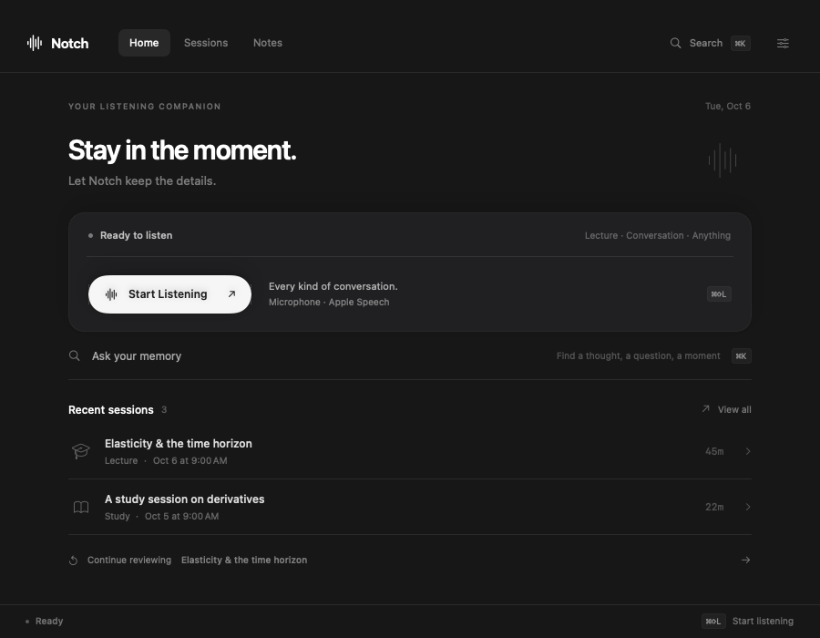
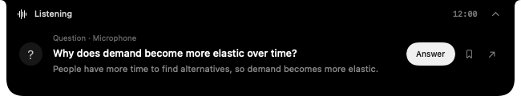
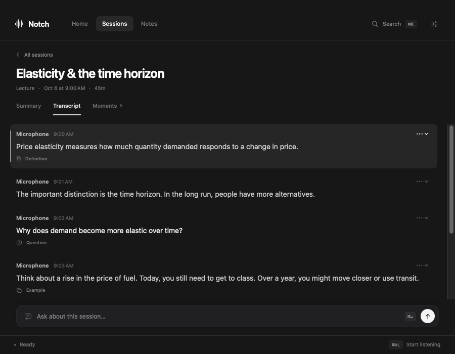
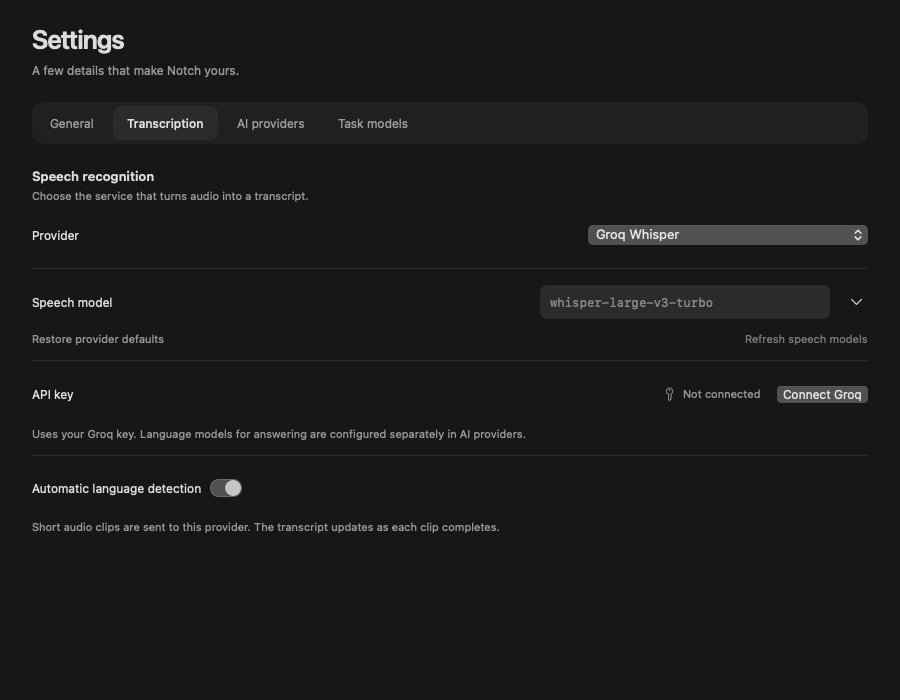

# Native companion design

The interface takes inspiration from the compact interaction surfaces in Cluely and HeyClicky. The implementation uses original SwiftUI layouts, system fonts and SF Symbols; no reference-brand graphics or code are included.

## Reference study

- [Cluely's product interface](https://cluely.com/) and [Live Insights guide](https://docs.cluely.com/feature/liveinsights): compact command bars, short contextual actions, a focused input area, and source passages with inline speaker/time metadata.
- [HeyClicky's official changelog](https://www.heyclicky.com/changelog): a small resting notch, an intermediate peek, and a deliberate expansion into the larger workspace. Its Home and settings screenshots use dark, rounded surfaces with a strong primary action and restrained supporting controls.

The relevant design principles are compactness, legible hierarchy and keeping the user in their current activity. They inform the layout and transitions; features outside this listening companion's scope are not imported.

## Visual system

`DesignSystem.swift` supplies a near-black canvas, two charcoal surface levels, fine separators, white primary actions, subdued secondary controls and small keyboard hints. The main window defaults to 900 × 700 points. A compact top navigation replaces the permanent sidebar so the session and its content occupy the window.

Home presents one listening action surface and short recent-session rows. Review content reads as a document. Transcript metadata sits close to its passage, while classification and passage actions remain quiet. Notes and memory use compact inputs consistent with the listening controls.

Settings separates General, Transcription, AI providers and Task models. Built-in providers expose the settings the user needs to choose: credentials and models. Arbitrary endpoint configuration belongs to Custom. Groq's speech and language models are kept visibly separate.

The physical notch remains black. Its resting indicator is compact; detected questions reveal a shallow horizontal surface with short actions. Detailed answers and editing open the main window. The active listening state stays visible.

## Rendered review

`DesignPreviewTests` renders the shipping views using fictional fixture data on macOS CI. It creates Home, session review, transcript, notes, memory, settings, Groq configuration and notch PNGs. The debug-only model initializer does not read Keychain or saved sessions and does not start capture, timers or network requests.

The workflow uploads the images as **Notch-Design-Previews**. Inspect these for visual hierarchy, text wrapping, control contrast, clipping and empty states. Rendering is a useful layout check; real-device audio, physical camera geometry and animation feel still require an interactive macOS run.

### Reviewed screens

These committed images come from source commit `043a635a5aecc49cdae0455e6e879329cb8111f9`, verified by [macOS CI](https://github.com/Luvi-1/notch-meeting-assistant/actions/runs/37511546785). The run passed 62 tests, rendered 13 states, and built the universal application. The render harness captures SwiftUI content with fictional data; it does not include the desktop or native window controls.

**Home — 900 × 700.** One primary action, two recent sessions, and Continue Reviewing visible without scrolling at the default size.

**The listening notch.** The compact indicator uses a reserved camera gap. A question expands the same surface horizontally to a 650 × 120 preview in this fixture.

**Transcript.** Source, time, moment classification and passage actions remain close to the text. The selected passage has a quiet highlight.

**Groq transcription.** Speech model selection is separate from the answering model. Saved keys are never displayed in the field. This fixture has no credential.

